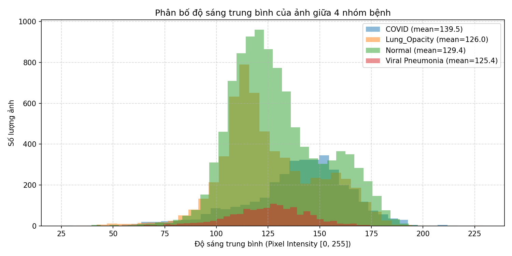

# CHƯƠNG 2. DỮ LIỆU VÀ PHƯƠNG PHÁP NGHIÊN CỨU

## 2.1. Nguồn gốc bộ dữ liệu và độ tin cậy thông tin

Đề tài dùng bộ COVID-19 Radiography Database công bố trên Kaggle, tổng hợp trong hai bài báo của Chowdhury và cộng sự [1] và Rahman và cộng sự [2]. Bộ dữ liệu gồm 21.165 ảnh X-quang lồng ngực dạng PNG, kích thước 299 × 299 điểm ảnh, thuộc bốn lớp. Con số này đếm trực tiếp từ `splits/split_v1.csv` sau khi quét toàn bộ tệp ảnh và khớp với số liệu hai bài báo công bố [1], [2].

**Bảng 2.1: Thành phần bốn lớp theo nguồn gốc**

| Lớp | Số ảnh | Nguồn thành phần |
| :--- | ---: | :--- |
| COVID | 3.616 | Sáu kho công khai; lớn nhất là BIMCV-COVID19+ với 2.474 ảnh |
| Lung_Opacity | 6.012 | Toàn bộ từ cuộc thi RSNA Pneumonia Detection Challenge |
| Normal | 10.192 | 8.851 ảnh RSNA và 1.341 ảnh từ bộ `Chest X-Ray Images (Pneumonia)` |
| Viral Pneumonia | 1.345 | Toàn bộ từ bộ `Chest X-Ray Images (Pneumonia)` |

Bốn lớp không đến từ cùng một nguồn. Lớp Lung_Opacity và lớp Viral Pneumonia lấy trọn từ một nguồn duy nhất. Lớp Normal ghép hai quần thể: 8.851 ảnh RSNA và 1.341 ảnh còn lại. Lớp COVID ghép sáu kho công khai, trong đó BIMCV-COVID19+ chiếm 2.474 ảnh [2]. Bộ cung cấp lớp Viral Pneumonia cũng cung cấp 1.341 ảnh của lớp Normal, và nhiều khả năng đây là ảnh X-quang nhi khoa do Kermany và cộng sự thu thập [3].

Bài báo mô tả lớp COVID gồm bốn nguồn cộng lại chỉ được 3.615 ảnh, ít hơn một ảnh so với con số công bố. Đối chiếu tệp metadata cho thấy nguồn BIMCV có 2.474 dòng thay vì 2.473 như lời văn, nên tổng thực tế vẫn là 3.616 [2].

Nhãn bốn lớp được kế thừa trực tiếp từ các kho nguồn. Hai bài báo không mô tả bước tái thẩm định nhãn độc lập cho toàn bộ 21.165 ảnh, không cung cấp mã bệnh nhân, tuổi hay giới tính, và chỉ nêu thông tin thiết bị chụp cho một nguồn con của lớp COVID [2]. Mặt nạ phổi đi kèm 21.165 tệp, đều ở kích thước 256 × 256 nên không khớp với ảnh 299 × 299; `splits/manifest.csv` ghi `mask_match_size = False` cho cả 21.165 cặp. Các kịch bản che mặt nạ của RQ3 vì thế phải nội suy mask về kích thước ảnh trước khi trích đặc trưng.

Bộ dữ liệu được phát hành với nhãn giấy phép `copyright-authors` kèm dòng hướng dẫn dùng cho mục đích học thuật và phi thương mại. Đề tài chỉ dùng bộ dữ liệu trong phạm vi đó.

## 2.2. Phân tích khám phá dữ liệu và nguy cơ học lối tắt từ độ sáng và metadata tệp

Với một bộ dữ liệu ghép từ nhiều nguồn, độ sáng là thuộc tính đầu tiên cần kiểm tra, vì một mô hình có thể nhận ra lớp nhờ nền ảnh sáng hay tối thay vì nhờ tổn thương phổi. Độ sáng được đo bằng trung bình mảng điểm ảnh của tệp gốc trên thang 0–255, tính một lần cho 21.165 ảnh và lưu trong `splits/manifest.csv`; mọi số dưới đây tính từ tệp đó. Bảng 2.2 tổng hợp theo lớp, Hình 2.1 vẽ phân bố đầy đủ.

**Bảng 2.2: Độ sáng trung bình theo lớp (thang 0–255)**

| Lớp | n | Trung bình ± SD | Trung vị | Khoảng tứ phân vị | Nhỏ nhất | AUC so với ba lớp còn lại |
| :--- | ---: | ---: | ---: | ---: | ---: | ---: |
| COVID | 3.616 | 139,5 ± 25,0 | 142,6 | 126,9–156,0 | 25,5 | 0,6585 |
| Lung_Opacity | 6.012 | 126,0 ± 23,6 | 120,8 | 110,6–142,1 | 32,2 | 0,4269 |
| Normal | 10.192 | 129,4 ± 22,4 | 125,5 | 113,5–143,6 | 26,4 | 0,4802 |
| Viral Pneumonia | 1.345 | 125,4 ± 19,0 | 126,9 | 113,5–137,8 | 64,8 | 0,4557 |

*(SD là độ lệch chuẩn mẫu; khoảng tứ phân vị là khoảng từ phân vị 25% đến phân vị 75%; AUC là xác suất một ảnh của lớp sáng hơn một ảnh ngẫu nhiên của ba lớp còn lại.)*

**Hình 2.1: Phân bố độ sáng trung bình của bốn lớp**

Bốn lớp đều có trung vị nằm trong dải 120,8–142,6, nhưng vị trí trong dải không đều. COVID sáng nhất với trung vị 142,6, cao hơn Lung_Opacity 21,8 đơn vị; ba lớp còn lại xếp sát nhau trong khoảng 120,8–126,9. Độ lệch chuẩn 19,0–25,0 và khoảng tứ phân vị rộng 24,3–31,5 đơn vị, tức biến thiên bên trong một lớp cùng cỡ với chênh lệch giữa hai trung vị xa nhất. Ba lớp có ảnh tối xuống dưới 33, riêng Viral Pneumonia không có ảnh nào dưới 64,8 và vì thế không có ảnh gần như đen.

Ngoài trung vị, mỗi lớp được tính một giá trị AUC: xác suất một ảnh của lớp đó sáng hơn một ảnh lấy ngẫu nhiên từ ba lớp còn lại. COVID đạt 0,6585, nghĩa là trong hai ảnh chọn ngẫu nhiên, một của COVID và một của lớp khác, ảnh COVID sáng hơn với xác suất khoảng 66%. Ba lớp còn lại có AUC từ 0,4269 đến 0,4802. Giá trị dưới 0,5 chỉ cho biết lớp đó tối hơn phần còn lại, nên mức tách được đo bằng khoảng cách đến 0,5: COVID cách khoảng 0,16, Lung_Opacity 0,07, Viral Pneumonia 0,04 và Normal 0,02. Trên toàn bộ dữ liệu, 46,5% ảnh nằm trong khoảng tứ phân vị của Normal; nếu bốn phân bố trùng nhau thì tỉ lệ này là 50%, nên mức lệch tổng thể không lớn. Độ sáng tách COVID ở mức vừa, tách Lung_Opacity yếu, và gần như không tách Normal hay Viral Pneumonia. Vì vậy nó không đủ để giải thích lối tắt cho cả bốn lớp.

Một dấu vết khác nằm ở metadata của tệp. Có 140 trong 1.345 ảnh Viral Pneumonia (10,4%) lưu ở hệ màu RGB, ba lớp còn lại không có ảnh RGB nào. Toàn bộ 140 ảnh này có ba kênh bằng nhau (R = G = B), và pipeline ép mọi ảnh về ảnh xám 8-bit trước khi trích đặc trưng, nên giá trị điểm ảnh sau chuyển đổi trùng với ảnh xám; bản thân định dạng tệp không tạo ra khác biệt đặc trưng. Định dạng khác nhau cho thấy nhóm ảnh này nhiều khả năng không đi qua cùng một bước xuất tệp với phần còn lại của lớp. Dấu hiệu đó chỉ phủ 10,4% lớp Viral Pneumonia, phần còn lại không khác biệt ở các thuộc tính đã kiểm, nên nó không đủ để giải thích cả lớp.

Mốc A0 ở mục 1.2 là phép thử trực tiếp cho hai kênh này. Random Forest chỉ dùng độ sáng trung bình và cờ is_rgb đạt macro-F1 0,2397 trên validation, cao hơn 0,1627 của mốc đoán toàn bộ Normal nhưng còn xa 0,8599 của nhóm đặc trưng ghép. Hai kênh này vì thế tự chúng không đủ để phân loại. Tuy vậy A0 chỉ dùng một con số độ sáng, trong khi histogram và các đặc trưng khác giữ nhiều thông tin cường độ hơn, nên A0 là cận dưới của mức lối tắt từ cường độ chứ chưa loại trừ được nó.

Những quan sát trên mới mô tả dữ liệu và một mốc tham chiếu đơn giản; chúng chưa cho biết mô hình dùng đặc trưng ảnh có dựa vào các dấu hiệu đó hay không. Việc đo nằm ở RQ3: che vùng phổi hoặc chỉ giữ vùng ngoài phổi rồi so macro-F1 với ảnh gốc. Chương 4 trình bày năm kịch bản của phép đo này.

## 2.3. Lọc trùng lặp bằng pHash ngưỡng T = 0

Ảnh trùng lặp rơi vào cả train và test sẽ thổi phồng điểm số, nên bước lọc chạy trước phép chia. Mỗi ảnh được tính mã MD5 của tệp và pHash 64-bit DCT; khoảng cách Hamming giữa hai mã pHash được tính theo công thức:

$$D = \frac{64 - u \cdot v}{2} \qquad (2.1)$$

với $u$ và $v$ là hai vector bit đã đổi sang dạng $\{-1, 1\}$. Các ảnh có $D = 0$ được gom vào cùng một nhóm bằng thuật toán Union-Find, và định danh nhóm đó trở thành cột `group_id` trong `splits/split_v1.csv`.

Kết quả trên 21.165 ảnh: 20.942 nhóm, trong đó 178 nhóm chứa nhiều hơn một ảnh với tổng cộng 401 ảnh, số còn lại là 20.764 nhóm chỉ có một ảnh. Không có nhóm nào chứa ảnh của hai lớp khác nhau. Toàn bộ ảnh trong cùng một nhóm được gán về cùng một tập trước khi chia 70/15/15, nên ảnh trùng khít không thể xuất hiện đồng thời ở hai tập.

Ngưỡng $T = 0$ được chọn sau khi thực nghiệm ba ngưỡng 0, 4 và 8 trên cùng một tập dữ liệu. Ngưỡng này chỉ loại ảnh trùng khít; các cặp còn gần trùng ở khoảng cách Hamming từ 1 đến 4 không bị gom nhầm và được phân tích riêng ở mục 2.5.

## 2.4. Phân chia train/val/test 70/15/15 và cơ chế khóa tập test

Phép chia dùng StratifiedGroupKFold với 20 fold và `random_state = 42`, giữ nguyên `group_id` trong mỗi tập và phân tầng theo nhãn theo tỷ lệ mục tiêu 70/15/15. Kết quả ghi trong `splits/split_v1.csv` và được tóm tắt ở Bảng 2.3.

**Bảng 2.3: Phân bố bốn lớp theo tập train, validation và test**

| Lớp | Tổng | Train | Val | Test |
| :--- | ---: | ---: | ---: | ---: |
| COVID | 3.616 | 2.536 | 537 | 543 |
| Lung_Opacity | 6.012 | 4.205 | 903 | 904 |
| Normal | 10.192 | 7.132 | 1.531 | 1.529 |
| Viral Pneumonia | 1.345 | 942 | 203 | 200 |
| **Tổng cộng** | **21.165** | **14.815** | **3.174** | **3.176** |

Tỷ lệ từng lớp trong mỗi tập lệch tối đa 0,1% so với tỷ lệ chung, đủ để gọi là phân tầng. Tệp split được băm SHA-256 với giá trị `f99e03d3d5cfc32f2bbc9befbdef45a07a256458a837a6d420a6658ed7583d98`; bài kiểm thử `tests/test_split.py` đối chiếu băm và số dòng từng tập, nên một thay đổi của tệp split sẽ làm bộ kiểm thử thất bại.

Tập test bị khóa trong suốt các giai đoạn chọn đặc trưng và chọn bộ phân loại. Mã nguồn mặc định `allow_test = False`, và mọi quyết định của RQ1 đến RQ3 chỉ dùng 3.174 ảnh validation. Tập test được mở đúng một lần vào lúc 07:43:34 UTC ngày 09/11/2026. Tệp `results/final_test/UNLOCK_RECORD.json` ghi lại lần mở khóa đó kèm commit `5720e4f`, mã băm SHA-256 của tệp split, mã băm của chuỗi xác nhận do người dùng ký, và macro-F1 validation 0,9024 của mô hình đã chốt. Sáu cổng kiểm soát G1–G6 phải vượt qua liên tiếp trước khi đánh giá trên tập test được thực hiện.

---

## Ghi chú kỹ thuật (không thuộc nội dung báo cáo)

- **Chương này chưa đủ mục.** Hiện đã có 2.1–2.4; các mục 2.5 và 2.6–2.9 theo đề cương trong [`report/README.md`](README.md) sẽ viết tiếp. Số bảng, số hình và số công thức đánh theo thứ tự xuất hiện trong chương, không theo số mục: Bảng 2.1 nằm ở mục 2.1, Bảng 2.2 và Hình 2.1 nằm ở mục 2.2, Bảng 2.3 ở mục 2.4, công thức (2.1) ở mục 2.3.
- **Tiêu đề các mục giữ theo `docs/report_standards.md` mục 3.2**, kể cả mục 2.2 (xem ghi chú riêng bên dưới).
- **Tiêu đề mục 2.2 đã đổi** thành "từ độ sáng và metadata tệp" vì phát hiện về định dạng RGB không nằm trong khái niệm cường độ sáng. Tên này **lệch** với tiêu đề cố định trong `docs/report_standards.md` mục 3.2 và trong `report/README.md`. Hai phương án: khôi phục đúng tên chuẩn, hoặc sửa cả ba chỗ cho khớp. Chưa chốt, chờ quyết định của người duyệt.
- **Nguồn số liệu:** số trong Bảng 2.1 và các số dẫn xuất (AUC, khoảng cách đến 0,5, 46,5%, 140 ảnh RGB) sinh bằng `python -m src.eda_brightness` từ `splits/manifest.csv`, ghi ra `results/eda/brightness_by_class.csv` và `results/eda/brightness_channels.json`. Kiểm thử `tests/test_eda_brightness.py` đối chiếu CSV với manifest. Bảng trong văn bản lấy từ `format_markdown_table` của script rồi dán sang, nên nếu sửa tay một ô thì phải đối chiếu lại CSV; test không bắt được lỗi gõ lại.
- **Nguồn mục 2.1:** `docs/dataset_provenance.md` mục 2.1 (thành phần bốn lớp, số lượng từng nguồn), mục 2.2 (giấy phép, tệp `.metadata.xlsx`), mục 3.2 (kích thước ảnh 299 × 299, mask 256 × 256, `mask_match_size = False`) và mục 3.1 (nhãn kế thừa, thiếu `patient_id`, tuổi, thiết bị). Số đếm 21.165 / 10.192 / 6.012 / 3.616 / 1.345 đối chiếu lại bằng pandas trên `splits/split_v1.csv`. Chênh lệch 3.615 so với 3.616 của lớp COVID ghi ở `docs/dataset_provenance.md` mục 2.3 hàng 1.
- **Nguồn mục 2.3:** `splits/README.md` mục 3 (phương pháp MD5 + pHash + Union-Find, 178 nhóm, 401 ảnh, 0 nhóm lệch nhãn) và `notebooks/02_duplicates_and_split.ipynb`. Lưu ý cách đọc số: tệp `splits/README.md` ghi "20.764 ảnh duy nhất", nhưng đếm trên `splits/split_v1.csv` cho thấy 20.764 là số *nhóm chỉ có một ảnh*, còn tổng số nhóm là 20.942 (178 + 20.764). Báo cáo ghi theo cách thứ hai để không hiểu nhầm.
- **Nguồn mục 2.4:** `splits/README.md` mục 2 (bảng phân bố theo lớp, $20$ fold, `random_state = 42`, lệch tối đa $\pm 0,1\%$) và mục 5 (khóa tập test, một lần mở duy nhất); SHA-256 từ `splits/split_v1.sha256`; lần mở khóa và macro-F1 0,9024 từ `results/final_test/UNLOCK_RECORD.json`; sáu cổng G1–G6 từ `results/final_test_protocol_record.md` mục 2. Không đưa bất kỳ số liệu nào của tập test vào chương này.
- **Chữ viết tắt:** pHash (perceptual hash, băm tri giác), MD5, DCT (discrete cosine transform, biến đổi cosine rời rạc), SD (độ lệch chuẩn mẫu), AUC, PNG, RF/GB/LR/k-NN/DT sẽ được giải thích ở lần xuất hiện đầu trong các mục còn lại, khớp danh mục ký hiệu ở phần mở đầu.
- **Định nghĩa độ sáng:** trung bình mảng điểm ảnh của tệp gốc, thang 0–255, do `notebooks/01_download_and_eda.ipynb` cell 3 tính. Manifest ghi cả 21.165 ảnh đều 299 × 299, nên khác biệt độ sáng không đến từ kích thước ảnh.
- **Làm tròn:** độ sáng một chữ số thập phân, AUC bốn chữ số, số gốc sáu chữ số nằm trong CSV; một số giá trị rơi đúng mốc ,xx5 (trung vị 142,595, q1 126,885, 0,6585 − 0,5 = 0,1585) nên bảng dừng ở đó thay vì làm tròn thêm.
- **AUC:** tính bằng hạng trung bình (Mann–Whitney U) nên xử lý được giá trị đồng hạng. Không dùng p-value vì với n = 21.165, Kruskal–Wallis hầu như luôn bác bỏ giả thuyết không và không cho biết mức tách lớp.
- **Mốc A0:** macro-F1 0,2397 lấy từ `results/a0_shortcut/metrics.json` (khoá `random_forest`); hai đặc trưng `brightness` và `is_rgb` theo `kaggle/baseline/04_baseline.ipynb` cell 3; B0 = 0,1627 theo `results/threshold_v3.md` mục 3; 0,8599 là macro-F1 của nhóm ghép ở RQ1 (`results/report_rq1/r1_summary.csv`). Mô tả của A0 trong mục 1.2 đã đổi thành "hai đại lượng đơn giản của tệp ảnh" cho khớp với định nghĩa độ sáng ở trên.
- **Ảnh RGB:** ghi chú "140 ảnh RGB có R = G = B" đã có trong `results/threshold_v3.md` mục 3; `src/dataset.py` ép `img.convert("L")` trước khi trích đặc trưng.
- **Hình:** `results/eda/brightness_distribution.png` do notebook cell 6 sinh, chưa vẽ lại. Khi chuyển sang Word, chèn ảnh và đặt chú thích Hình 2.1 bên dưới, cỡ 10–11 pt.
- **Chưa đưa vào chương:** không có số liệu tập test; RQ1–RQ3 để Chương 3–4.
